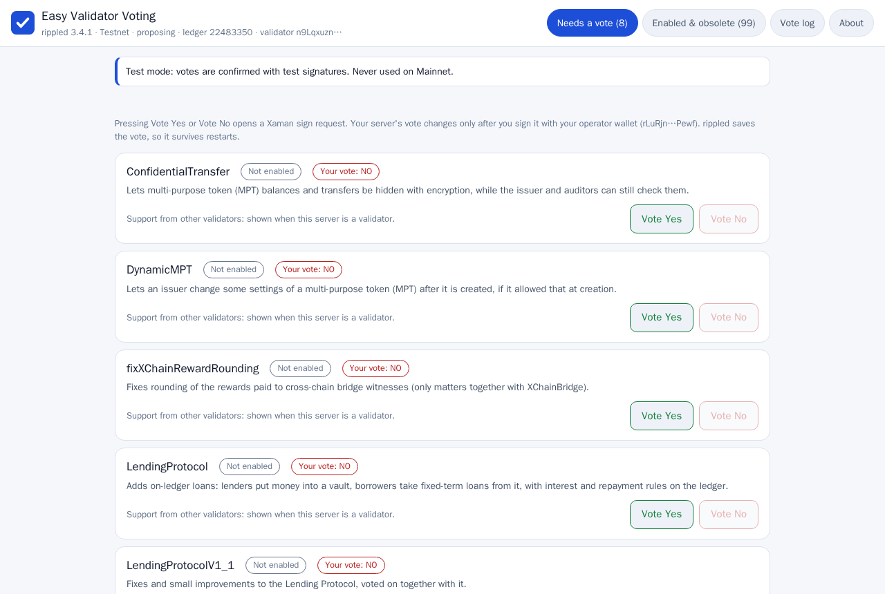
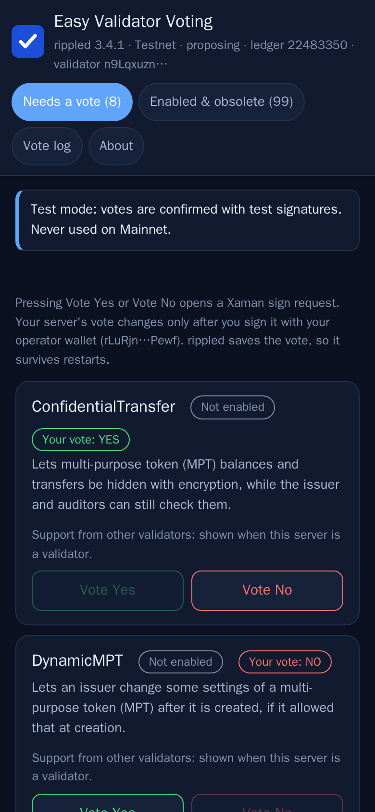
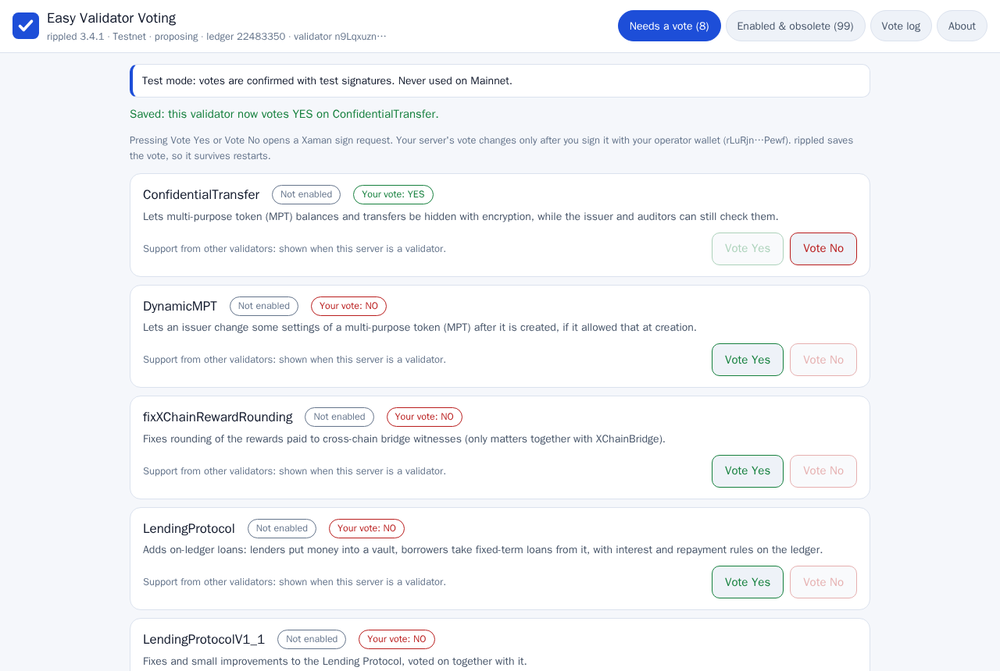
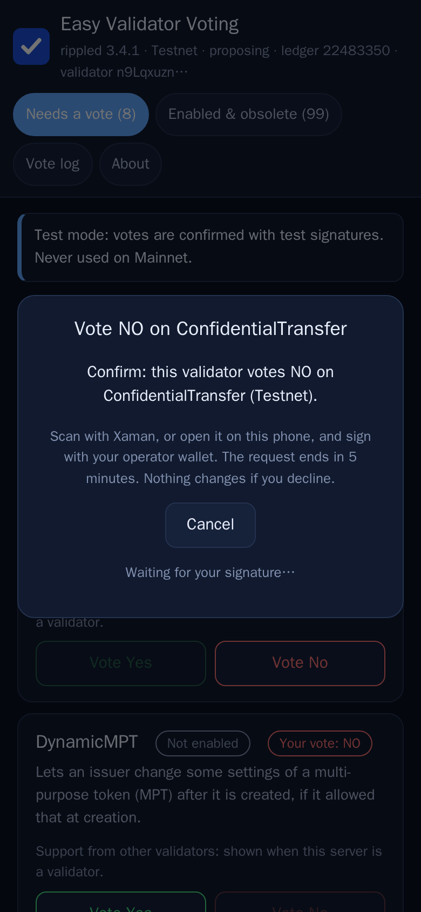

# Nexus North Easy Validator Voting

A small web page for XRP Ledger validator operators. It shows every amendment your rippled knows about in plain English, with how much support it has from other validators, how many days are left if it has a majority, and how *your* validator currently votes. Every amendment that is still open has **Vote Yes** and **Vote No** buttons.

Every vote is confirmed with a **Xaman sign request** from your own operator wallet. Nothing changes on your server until you sign.

It runs on the same machine as your rippled. It talks only to rippled's local admin port and never opens it to anyone.

| Desktop | Phone |
|---|---|
|  |  |
|  |  |

*(Screenshots are from a throwaway Testnet validator in test mode, where the Xaman QR code is replaced by a test signature.)*

## What you get

- **Every amendment**, enabled or not, with a short plain-English summary. Always read the full description at [xrpl.org/resources/known-amendments](https://xrpl.org/resources/known-amendments) before you vote.
- **Support from other validators.** For example, "25 of 36 trusted validators (69.4 %), needs 28 (80 %)", with a bar. If an amendment has a majority, it shows when the majority started and how many days are left.
- **Your current vote** on each open amendment, as rippled reports it.
- **Yes / No buttons.** Each press creates a Xaman sign request for that one vote. Your rippled's vote changes only after you sign it with an operator wallet you chose during setup.
- **Votes survive restarts.** The vote is set with rippled's own `feature` command, and rippled stores it in its own database.
- **A vote log.** Every vote made through the page is logged with the time, amendment, vote, signing wallet and result. Refused attempts are logged too.
- **Optional Telegram alerts** when a new amendment appears, or when one you haven't voted on reaches 70 % support (you can change the threshold).
- **Desktop and phone**, light and dark mode. No outside fonts, scripts or trackers.

## Requirements

- Linux with systemd, on the **same machine as your rippled**. Windows and macOS are planned; for now you can use Docker there.
- **Node.js 20 or newer.** The app has **no npm dependencies** at run time.
- A rippled **admin port on 127.0.0.1**, for example this in `rippled.cfg`:
  ```
  [port_rpc_admin_local]
  port = 5005
  ip = 127.0.0.1
  admin = 127.0.0.1
  protocol = http
  ```
- The **Xaman** app on your phone, with your operator wallet in it.
- A free **Xaman developer app** (API key + secret) from [apps.xumm.dev](https://apps.xumm.dev). This lets the app create sign requests for you.

## Install (Linux, one command)

```bash
curl -fsSL https://raw.githubusercontent.com/nexus-north-xrpl/nexus-north-easy-validator-voting/main/install.sh -o install.sh
less install.sh        # it is short; please read it
sudo bash install.sh
```

Or, from a copy of this repository: `sudo ./install.sh`.

The installer:
1. checks for Node.js 20+;
2. creates a system user `evv`, with no login shell;
3. copies the app to `/opt/easy-validator-voting`;
4. keeps settings and the vote log in `/var/lib/easy-validator-voting` (readable only by `evv`);
5. runs the guided setup;
6. starts the systemd service `easy-validator-voting` in a sandbox (it can only write its own data folder).

It does **not** change rippled or `rippled.cfg`, and it does not open firewall ports.

### The guided setup

The setup asks for, and tests, each of these:

1. **rippled admin URL.** The default is `http://127.0.0.1:5005`. Only addresses on this machine are accepted. The setup checks that admin access works and says whether the server is a validator.
2. **Operator wallet address(es).** These are the only wallets allowed to confirm votes. Enter public addresses only (they start with `r`), never a secret.
3. **Xaman API key and secret** from your Xaman developer app. The setup checks them with Xaman.
4. **Where the page listens.** The default is `127.0.0.1:8742`, so only this machine can open it.
5. **Optional Telegram** bot token and chat id. The setup sends a test message.

To change settings later, run the setup again, then restart:
```bash
sudo -u evv EVV_DATA_DIR=/var/lib/easy-validator-voting node /opt/easy-validator-voting/src/setup.js
sudo systemctl restart easy-validator-voting
```

### Open the page

- **On the server itself:** http://127.0.0.1:8742
- **From your laptop or phone (recommended):** use an SSH tunnel. Nothing gets exposed to the network.
  ```bash
  ssh -L 8742:127.0.0.1:8742 you@your-validator
  ```
  Then open http://127.0.0.1:8742 on the device running the tunnel. Phone SSH apps such as Termius can do the same.
- **On your LAN:** in the setup, set the page address to `0.0.0.0`. Every vote still needs your Xaman signature, but anyone on that network can see the page. Never forward this port to the internet.

## Docker

```bash
git clone https://github.com/nexus-north-xrpl/nexus-north-easy-validator-voting.git
cd nexus-north-easy-validator-voting
mkdir data && sudo chown 1000:1000 data
docker compose build
docker compose run --rm -it easy-validator-voting node src/setup.js
docker compose up -d
```

The container uses host networking, so it reaches rippled at `127.0.0.1` the same way rippled's own tools do. It runs read-only, as a normal user, with all extra capabilities dropped.

## How a vote works

1. You press **Vote Yes** on an amendment.
2. The app creates a Xaman **SignIn** request that says, for example, "Confirm: this validator votes YES on SingleAssetVault (Mainnet)". A SignIn is never sent to the XRP Ledger and moves no funds. It only proves which wallet signed it.
3. You scan the QR code (or tap **Open in Xaman** on your phone) and sign with your operator wallet.
4. The app asks Xaman who signed. If it is one of your operator wallets, it sends this to your rippled's admin port:
   `{"method":"feature","params":[{"feature":"<amendment id>","vetoed":false}]}`
   (`vetoed: true` means No). Then it reads the vote back to confirm it.
5. The result goes into the vote log, and to Telegram if you set it up.

The request expires after 5 minutes and can be used only once. If you decline, it expires, or someone else's wallet signs it, nothing changes.

Voting pauses while rippled is still syncing, because the list can be incomplete then.

## Security: exactly what it touches

| What | How |
|---|---|
| **rippled** | Only the admin port on this machine (`127.0.0.1`, `localhost` or `::1`; other addresses are refused). Only three commands can ever be sent: `server_info`, `feature` and `ledger_entry`. `feature` with `vetoed` is sent only after a confirmed Xaman signature. It cannot sign or submit transactions, stop rippled, or change `rippled.cfg`. |
| **Xaman** (`xumm.app`) | Creating and checking sign requests, using *your own* Xaman developer app's API key and secret. |
| **Telegram** (`api.telegram.org`) | Only if you set up alerts. |
| **Your files** | Only its own data folder: `config.json` (mode 600) and `votes.jsonl` / `alerts.json`. |
| **Everything else** | Nothing. No analytics, no tracking, no update checks, no outside fonts or scripts. The page's browser rules (Content-Security-Policy) block loading anything from other sites. |

Keys and secrets:
- It **never** asks for, receives or stores a wallet secret, seed or private key. Votes are confirmed by signing in Xaman, on your phone.
- The Xaman API key and secret are stored only in `config.json` on your server, and are sent only to xumm.app.
- The admin port is never opened or forwarded. Keep it on `127.0.0.1` in `rippled.cfg`.

The page itself:
- By default it listens on `127.0.0.1` only.
- The vote buttons accept requests only from the page itself (same origin, JSON), so another website can't press them for you.
- Settings can't be changed from the page, only with the setup on the server.

Please report security issues privately; see [SECURITY.md](SECURITY.md).

## Good to know

- **Only validators' votes count.** If your rippled is not a validator, the page still works, but it says that votes won't be counted and support numbers won't show.
- **`[veto_amendments]` / `[amendments]` in rippled.cfg** are the old way to set votes. If you use them, they can override votes set here. Remove them if you want to vote with this page.
- **Summaries** are short helpers. Always check the full description on xrpl.org.

## Uninstall

```bash
sudo bash /path/to/uninstall.sh            # keeps settings and the vote log
sudo bash /path/to/uninstall.sh --purge    # removes those too
```

Your votes stay in rippled; they are rippled's own setting.

## Development and tests

The test runs only against a **throwaway Testnet rippled** in its own Docker network, never against a real server. It needs Docker and a rippled image:

```bash
RIPPLED_IMAGE=<rippled or xrpld image> bash test/testnet/run.sh
```

It starts a fresh Testnet rippled, turns it into a throwaway Testnet validator, starts the app in test mode, and runs the browser test (which also takes the screenshots above). It then restarts rippled to check that the vote was saved, puts the vote back, and removes everything.

In test mode, votes are confirmed with locally signed test proofs instead of Xaman. Test mode is refused on Mainnet.

## License

MIT. See [LICENSE](LICENSE).
